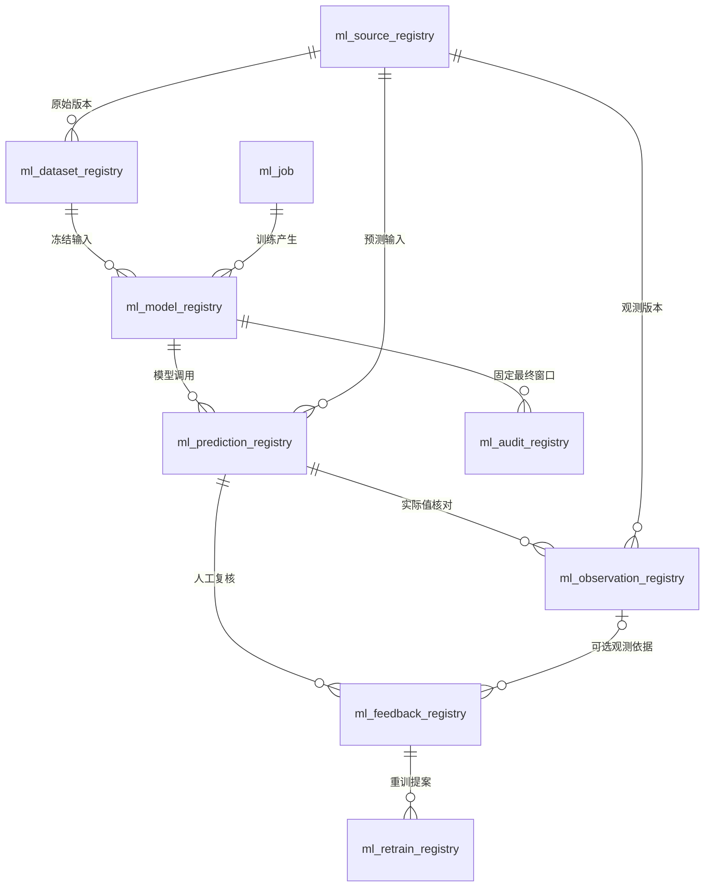

# GB10 数据库实施与使用

当前实现使用本项目的 SQLite 数据库，业务数据不来自参考软件。已有场站演示、公开历史研究、交易、智能体与审批记录保留各自来源和资格，不混为场站生产数据。

业务前端通过同一工作台合同访问这些仓储。统一交互不要求把电价、功率和不同来源的模型强行合并到同一标签表；后端在入口校验来源、任务、日期、模型与预测记录归属。场站模型的登记声明不当作真实训练成功证据，公开研究训练需成功作业和可加载权重。

本次统一不修改001—006迁移，也不重写旧库。场站新复核同时在原 `review_feedback` 追加意见，并在 `ml_event` 追加 `workbench_review_snapshot` 事件，绑定反馈、案例、预测、时段、当时实际值与预测值。实际值改变后旧确认不会沿用；未保存独立观测绑定的旧意见只在历史中展示。市场反馈继续关联不可变预测与观测核对对象。请求、完成和失败分别记录，提交训练成功只表示已提交，完成以作业实际状态为准。

## 数据放在哪里

- 数据库：GB10 `/home/priv/ZhongJieNeng/runtime/data/cecep.sqlite3`。
- 原始公开数据：既有PriceForecast CSV，只读。服务器按SHA256保留归档版本到 `runtime/ml/sources/`。
- 权重、样本清单、原生评估预测：服务器 `runtime/ml/`，数据库保存路径、哈希及关联。不会复制到工作站，也不把大型文件塞进数据库。
- `ml_object` 保存完整不可变证据；正式关系表保存有类型、有外键、可索引的业务关联；`ml_event` 保存状态变化，禁止用更新旧记录伪造新状态。

## 分层业务表

| 层 | 主要表 | 用途 |
| --- | --- | --- |
| 来源与输入 | data_source、ingestion_batch、station、station_config_version、weather_observation、weather_forecast、station_actual、station_forecast_snapshot、market_price、市场供需与事件表 | 来源、批次、场站、功率、气象、电价与修订。场站合成演示单独标记 |
| 输入证据 | feature_snapshot、feature_input | 某次任务实际使用的输入、截止时间及原始记录哈希 |
| 场站预测评估 | model_version、prediction_run、prediction_value、evaluation_run、evaluation_metric | 场站工作区的模型、预测值和评价；有接口不等于生产资格 |
| 交易与收益 | contract_position、bidding_plan、bidding_plan_item、rule_version、revenue_run、revenue_item | 明确规则下的方案与确定性沙盘结果，不把演示规则当正式浙江规则 |
| 智能体与复核 | agent_run、agent_tool_call、agent_session、agent_response、rag_document、rag_chunk、review_feedback、deviation_case、iteration_candidate、approval_decision、model_lifecycle_event | 问答证据、复核、提案和审批留痕 |
| 展示层 | serving_interval_wide、serving_daily_kpi、serving_version_compare | 可重建的页面聚合；不能作为训练源 |
| 公开研究 | 以下8张结构化关联表，加ml_object、ml_job、ml_event、public_reference_run | 公共省级历史数据的训练和研究链路，与场站生产资格分开 |

## 公开研究的8张正式关联表

| 表 | 核心字段与关联 |
| --- | --- |
| ml_source_registry | source_version_id、source_hash、source_mode、archive_path、archive_sha256、record_count、ingested_at；源哈希唯一，归档哈希必须一致 |
| ml_dataset_registry | dataset_id、source_version_id、source_hash、task、split_json、feature_schema_json；固定原始版本、切分和特征协议 |
| ml_model_registry | model_version_id、dataset_id、job_id、algorithm、task、unit、artifact_path、artifact_sha256、training_end、selection_end、final_start/end；外键绑定任务和数据集 |
| ml_prediction_registry | prediction_id、model_version_id、input_source_id/hash、trading_date、cutoff_at、unit、point_count、validation_only；96点与模型权重校验绑定 |
| ml_observation_registry | observation_id、prediction_id、source_version_id/hash、observed_points、changed_points、checked_at；一条预测在同一观测版本只核对一次 |
| ml_feedback_registry | feedback_id、prediction_id、observation_id、slot、reviewer_id、training_eligible；反馈不能挂到另一条预测的观测上 |
| ml_retrain_registry | proposal_id、feedback_id、dataset_id、parent_model_id、alpha、incorporates_labels；参数重训必须保留父模型的数据集，不把备注当标签 |
| ml_audit_registry | audit_id、model_version_id、task、window_start/end；同任务同最终窗口唯一，换源哈希不能刷新独立检验资格 |

这些不是空表。006迁移先按实际证据自动回填，再用触发器在同一事务里维护新记录；状态仍从事件投影，不改写旧对象。历史版本没有归档时，允许关联为空并明确缺口，不能伪造归档。当前登记和推理都会先保留所用源版本。

## 数据库约束与索引

- 8张关联表和证据表均禁止UPDATE/DELETE。只有serving_*允许重建。
- 外键检查模型、数据集、预测、观测、反馈与提案的真实归属；额外触发器防止模型关联到另一训练任务的数据集、预测权重不匹配、反馈串到另一条预测、参数重训偷换数据集。
- 为模型/交易日、预测/观测、源版本、数据集/模型、对象类型及最新事件建立索引。预测历史和最新观测已改用关联表查询。
- ml_job有唯一幂等键，重试另建任务；任务阶段、真实退出与错误追加到ml_event。控制器未知旧退出不冒称成功。
- 大型原始文件和NPZ始终按哈希校验；输入、权重、实际标签版本分别命名。新实际值只追加核对，不改旧预测，也不混入原模型评估。

## 迁移与保留

001—005已应用迁移保持原校验和。006只追加正式关系表、索引、语义约束和自动回填；不DROP旧表，不改旧证据，不替换数据库。迁移在事务中执行，发布前用线上库的隔离副本验证回填、完整性和外键；完成后删除该临时副本，主库与原资产保留。

来源时间仍分开：verified_arrival/verified_publication才能用于场站正式PIT查询；公开CSV没有历史到达时间，始终historical_assumed。本系统当前归档时间不是源数据的历史发布时间。现有公开数据、合成演示与场站生产数据不互相冒充。

## 查看实际结构

数据库表设计不在业务前端展示。本文件是表设计的维护入口；维护人员可使用 `GET /api/v1/research/schema` 核验当前表名、行数、字段和外键。

也可在服务器执行 `PYTHONPATH=src .venv/bin/python -m cecep_console.storage inspect` 核验版本、计数、完整性及外键。源码DDL在 `src/cecep_console/storage_sql/`，运行库、原始归档与权重不进入Git。

## 007多任务扩展

旧实时电价关系表的CNY/MWh及96点合同不重写。007仅追加六张任务关系表（`ml_*_registry_v2`）、`ml_business_scenario`及统一视图 `ml_models`、`ml_predictions`、`ml_observations`、`ml_feedbacks`、`ml_retrains`、`ml_audits`。旧RT投影与新任务投影按任务分派，调用层通过同一视图读取；没有第二套业务界面。

扩展模型绑定任务、数据集、实际作业与权重；预测检查MW或CNY/MWh单位、唯一时段网格及24/96点数。反馈、重训和审计绑定所属模型与预测；父节点一致性由触发器检查。最终窗口仍按任务、日期唯一，换源不能重置。业务测算用外键关联光伏日前预测、模型与观测归档，并保存系数、费用、共同结算时段和对照金额。全部追加不可变，旧表数据和旧证据不删除或覆盖。

## 008受控优化候选

001—007文件及历史校验和保持不变。008追加六张 `ml_*_registry_v3`、`ml_optimization_origin` 和 `ml_business_scenario_v3`，维护接口共列出23张研究关联表。新模型保存固定切分候选与原优化证据的关系，历史逐折权重不直接注册为日常模型。三个物理版本仍由同六个统一视图读取。

新候选保留模型、源归档、权重、单位、时间网格及预测关联约束，复核和量价测算不能挂错版本。全部记录追加保存。训练成功不会改写研究主版本；审批仍比较同信息条件、同日期时段和同标签的实际输出，不重置已消费的最终审计窗口。

统一业务案例及其分析调用保存于追加式 `ml_object` 和 `ml_event`，绑定原反馈、预测与观测快照。公开研究不冒用只接受场站数据模式的旧知识表；检索按来源、任务、创建时点和观测资格筛选。页面只展示业务名称与引用，内部关系由API和数据库保留。
